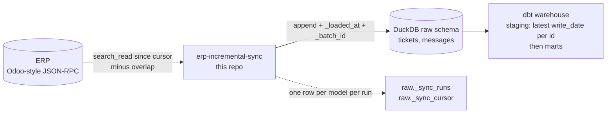
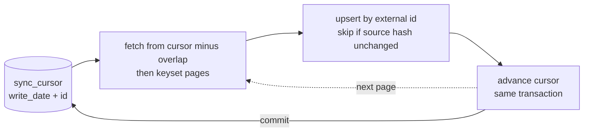

# erp-incremental-sync

Incremental ERP ingestion with a write_date cursor, an overlap window and dry-run: lands changed rows into SQLite, or append-only into the `raw` schema of a DuckDB + dbt warehouse with a queryable run log. Demonstrated against a mock Odoo-style JSON-RPC server with synthetic data.

## Where it fits

This is the ingestion layer for [support-analytics-warehouse](https://github.com/abdalrahmnamo-svg/support-analytics-warehouse), a DuckDB + dbt warehouse. That repo defines a raw landing contract (`raw.tickets`, `raw.messages`, each with `_loaded_at` and `_batch_id`); this repo can deliver rows in exactly that shape.



```bash
npm run mock-erp                                   # terminal 1: mock ERP on http://localhost:8069
npm run sync -- --target duckdb --warehouse ../support-analytics-warehouse/warehouse/support.duckdb --id-offset 900000
cd ../support-analytics-warehouse/dbt && dbt build # terminal 2: rebuild the warehouse on the landed rows
```

`--id-offset` puts the mock ERP's ids (1..60) in their own range so they do not collide with ids the warehouse generator already created. `--dry-run` works for this target too and writes nothing (no rows, no cursor, no run-log entry, no file). `npm run land:demo -- --warehouse <file.duckdb>` does a first load, edits three ERP records, loads again and prints the run log, with no server to start.

**Checked end to end** on a throwaway copy of the warehouse (the real repo was not touched): after the generator and `dbt build` gave `PASS=158 WARN=7 ERROR=0`, landing the mock ERP's 250 rows plus a second batch of 24 changed rows and running `dbt build` again gave `PASS=159 WARN=6 ERROR=0`. All 61 landed tickets reached `marts.fct_tickets`, and the edited ticket shows two raw versions with the latest one winning in staging.

### Raw is append-only, on purpose

Each run appends the rows it fetched; nothing is updated or deleted in `raw`. That is the usual landing pattern: raw keeps every delivered version, so you can audit what the source said and when, replay a bad transform, and recover from a bug downstream. Deduplication is a modelling decision and lives in the warehouse: its staging models keep the latest `write_date` per id (ties broken by `_loaded_at`). The overlap window means a normal run re-appends a few unchanged rows; they are identical versions, so they do not change the "latest per id" result (a test asserts this). The trade-off is storage growth proportional to the overlap, which is small, and a `raw` table that is not unique on its id.

### Run log: pipeline observability in SQL

Every non-dry run writes one row per model to `raw._sync_runs` (inserted as `running` at the start and updated when the model finishes, so a killed process leaves a visible `running` row; a failed model records `failed` and the error text). The cursor lives next to it in `raw._sync_cursor` and advances in the same transaction as each page.

```sql
SELECT batch_id, model, started_at, finished_at, fetched, appended, cursor_before, cursor_after, status, error
FROM raw._sync_runs
ORDER BY started_at DESC, model;

-- how much of each run was real change vs overlap re-read, and how long it took
SELECT batch_id, model, appended,
       date_diff('millisecond', started_at, finished_at) AS ms,
       status
FROM raw._sync_runs
WHERE started_at > now() - INTERVAL 7 DAY;
```

Output of the first query after `land:demo` (columns trimmed):

```
batch_id                     model             fetched  appended  cursor_after              status
erp_20261011T114545Z_l8pg    helpdesk.ticket   60       60        2026-02-01 09:00:00#60    success
erp_20261011T114545Z_l8pg    mail.message      190      190       2026-02-01 09:00:00#190   success
erp_20261011T114545Z_76pz    helpdesk.ticket   8        8         2026-10-11 11:45:45#61    success
erp_20261011T114545Z_76pz    mail.message      16       16        2026-10-11 11:45:45#194   success
```

Landed columns and types are exactly the warehouse contract: `raw.tickets` (`ticket_id BIGINT, external_ref, customer_id, channel, category, priority, stage VARCHAR, created_at, first_response_at, resolved_at TIMESTAMP, assigned_agent_id BIGINT, write_date TIMESTAMP, _loaded_at TIMESTAMP, _batch_id VARCHAR`) and `raw.messages` (`message_id BIGINT, ticket_id BIGINT, author_type VARCHAR, sent_at TIMESTAMP, body_chars BIGINT, write_date TIMESTAMP, _loaded_at, _batch_id`). The test suite asserts the names and types against a list copied from the contract, and the loader refuses to append into an existing `raw` table whose shape differs.

## CDC patterns: when to use which

| Pattern | How it finds changes | Strengths | Weaknesses | Use when |
|---|---|---|---|---|
| **Cursor + overlap** (this repo) | `write_date >= last cursor - overlap`, keyset-paged on `(write_date, id)` | Needs only a read API and a reliable modified timestamp; cheap; resumable; easy to reason about | Misses hard deletes; misses commits that land later than the overlap; trusts the source's `write_date` | SaaS/ERP APIs (Odoo, Salesforce style), no database access, moderate volume |
| **Log-based CDC** (Debezium, database WAL/binlog) | Reads the database transaction log | Sees every insert, update and delete in commit order; no load on source tables; low latency | Needs database-level access and a connector plus a broker to run; schema changes and replay need care | You own or can replicate the source database and need deletes, ordering or near-real-time |
| **Full snapshot** | Re-extracts the whole table each run | Simplest; self-healing; deletes show up as absences; no timestamp needed | Cost grows with table size; hammers the source; noisy diffs unless you compare snapshots | Small reference tables, sources with no usable change marker, or as a periodic reconciliation next to a cursor |

In practice these combine: a cursor sync for the daily flow, an occasional `--since` re-read or full snapshot to catch late commits and deletes. This repo covers the first and shows how a run is audited; it does not implement the other two.

## Problem

Pulling "everything" from an ERP on every run is slow, hammers the API, and makes re-runs risky. Pulling "what changed" is only safe if three things hold: a re-run never double-writes, a crash never skips rows, and you can preview what a run would do first. This repo shows one way to get all three with Node and a local database (SQLite by default, DuckDB for the warehouse target).

## How it works



## Tech

Node 24, built-in `node:sqlite`, `fetch` and `node:test`. The only runtime dependency is the official DuckDB client `@duckdb/node-api` (pinned), used by the `--target duckdb` path and loaded only when that target is selected. No Docker. The ERP is a small mock (`mock-erp/server.mjs`) speaking the `/jsonrpc` shape (`common.authenticate`, `object.execute_kw` with `search_read`) over seeded synthetic `helpdesk.ticket` and `mail.message` data. Tickets carry custom `x_*` fields (channel, category, customer and external reference, first response and resolution time) so the data can be mapped onto the warehouse contract; the SQLite path ignores them.

## Quick start

```bash
git clone https://github.com/abdalrahmnamo-svg/erp-incremental-sync.git
cd erp-incremental-sync
npm ci
npm run mock-erp                 # terminal 1: mock ERP on http://localhost:8069
npm run sync -- --dry-run        # terminal 2: plan only, writes nothing
npm run sync                     # first real sync
npm run sync                     # again: re-reads the overlap window, 0 writes
npm run mock-erp:mutate          # edit 2 tickets, create 1 ticket + 1 message in the mock ERP
npm run sync                     # picks up only those 4 rows
npm run sync -- --since 2026-01-01   # ignore the cursor, re-read from a date
```

Defaults match `.env.example`, so no `.env` is needed for the demo. The target database is `output/sync.db` (override with `SYNC_DB_PATH`). Run `npm test` for the test suite (the mock ERP is started in-process on a random port).

### Example: dry run on an empty target

```
ERP sync (DRY RUN: nothing will be written)
Connected as uid 1 (http://localhost:8069, db demo); target (read-only) output\sync.db
Start: stored cursor minus overlap | page size 50 | overlap 2s

helpdesk.ticket
  cursor  (none)  ->  2026-02-01 09:00:00 #60  (not saved)
  pages 2 | fetched 60 | would insert 60 | would update 0 | unchanged 0 | skipped 0
mail.message
  cursor  (none)  ->  2026-02-01 09:00:00 #190  (not saved)
  pages 4 | fetched 190 | would insert 190 | would update 0 | unchanged 0 | skipped 0
Plan: 250 row(s) would change.
Re-run without --dry-run to apply.
```

Re-running right after the first sync re-reads only the overlap window and writes nothing:

```
helpdesk.ticket
  cursor  2026-02-01 09:00:00 #60  ->  2026-02-01 09:00:00 #60
  pages 1 | fetched 6 | insert 0 | update 0 | unchanged 6 | skipped 0
mail.message
  pages 1 | fetched 15 | insert 0 | update 0 | unchanged 15 | skipped 0
Nothing to do: target is up to date.
```

After `npm run mock-erp:mutate`, the next sync reports `insert 1 | update 2` for tickets and `insert 1` for messages; everything else it re-read is `unchanged`.

## Duplicate cleanup: plan, review, apply, rollback

The mock ERP deliberately contains three tickets that exist twice under different ids (same customer, subject and creation time). Cleaning that up is a reviewed, reversible workflow:

```bash
npm run dupes:plan                          # read-only; writes output/dupes-plan-<id>.json
# review the JSON: which ticket is kept, which messages move or are dropped
npm run dupes:apply -- output/dupes-plan-<id>.json --dry-run   # rehearse, then roll back
npm run dupes:apply -- output/dupes-plan-<id>.json             # apply, one transaction per group
npm run dupes:rollback -- output/dupes-plan-<id>.json          # restore the exact original rows
```

- The kept copy is the one with the most messages (ties: lowest id). Messages the keeper lacks are moved onto it; messages it already has are dropped with the removed ticket.
- Apply refuses any group whose rows changed since the plan was made (fingerprint check).
- Everything removed is stored in `dupe_backup`; rollback restores it byte for byte. The tests compare full table dumps before apply and after rollback.
- Removed ids go into `sync_suppress`, so a later sync (even `--since`) does not bring the duplicates back.

## Engineering notes

- **Idempotency.** Every row is keyed by the ERP's own id and written with an upsert. Each source record is hashed; if the hash matches the stored one the row is left alone, so re-delivery costs a SELECT and no writes. "Re-sync is a no-op" means zero writes (rows may be fetched, all classified `unchanged`); the test asserts SQLite's `total_changes()` does not move on a re-run.
- **Why an overlap window.** A strict "after the cursor" start can silently miss (1) a record with a lower id edited in the same second as the cursor, and (2) rows that commit late with a `write_date` slightly in the past (clock skew, long transactions). So each run starts from `write_date >= cursor.write_date - SYNC_OVERLAP_SECONDS` (default 2, set in `.env`), then pages by keyset within the run. The re-read rows are cheap because unchanged rows cost no writes. The cursor still never moves backwards and still advances in the same transaction as its page. Remaining limit: an edit that commits later than the overlap window is not seen by a normal run (use `--since`, which re-reads from a date), and hard deletes are never detected.
- **write_date ties.** Many records can share one `write_date` (bulk edits, imports). Paging on `write_date > cursor` alone would skip or repeat rows at a page boundary. The cursor is the pair `(write_date, id)` and the page filter is `write_date > w OR (write_date = w AND id > i)`, ordered by `write_date asc, id asc`. The mock data puts six tickets on every timestamp and a test pages with size 4 to cross those boundaries.
- **Why the cursor advances only after commit.** The cursor update is in the same transaction as the page's upserts. If a page fails, both roll back together, so the cursor can never run ahead of the data. A failed run resumes from the last committed page; the failure test checks this and that no row is duplicated.
- **Dry-run.** It runs the real fetch and classification logic against a read-only connection (or an empty in-memory database if the file does not exist), so it creates no file and writes no cursor.
- **`--since`.** Replaces the stored cursor (and overlap) as the starting point for that run. The stored cursor never moves backwards.
- **PII choice.** The source system coupled sync to an encrypted vault. This repo removes that coupling: contact fields (name, email, phone) are stored as plain text and the data is synthetic (`@example.com`, `+1-555-01xx`). Identity matching uses normalized email, then phone. For field-level encryption see the companion `pii-field-encryption` repo. The default projection masks email and phone on display.

## Limitations

- Deletes in the ERP are not detected. Cursoring by `write_date` sees changes, not absences.
- Late commits older than the overlap window are not detected by a normal run; schedule an occasional `--since` re-read if your ERP can commit that late.
- Relations are not enforced: messages are synced after tickets and are keyed by ticket id without a foreign key.
- The mock supports only `search_read`, `search_count`, `read` and the domain operators used here (`=`, `!=`, `>`, `>=`, `<`, `<=`, `in`, `not in`, `&`, `|`, `!`).
- Single writer: run one sync at a time against a target database.
- DuckDB target: the duplicate cleanup (`dupes:*`) is SQLite-only; raw keeps ERP-side duplicates as delivered and leaves them to the warehouse. Hard deletes are not landed. ERP stage names are mapped to the warehouse vocabulary (`New`/`In Progress` to `open`, `Waiting` to `pending`, `Solved` to `solved`) and numeric priorities to `low`/`normal`/`high`/`urgent`; nothing else is cleaned in raw.
- The mock data is synthetic and the warehouse flags most landed rows as late-arriving (their `write_date` is far older than the load time); that is a property of the demo, not of the loader.

## Background

Extracted and generalized from an internal ERP integration, rebuilt around a mock server and synthetic data.

## License

MIT
